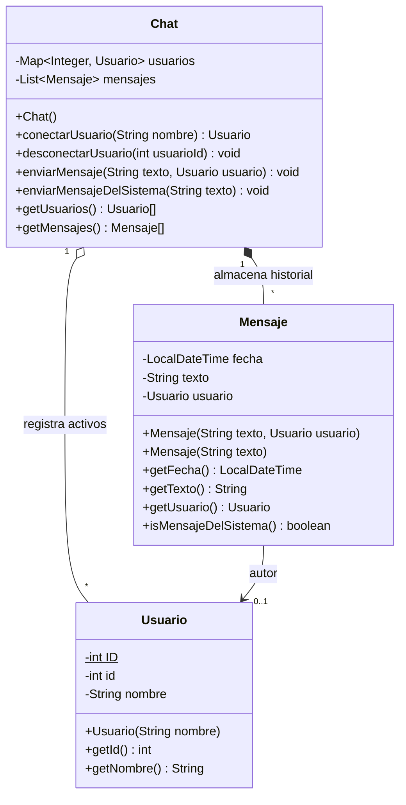
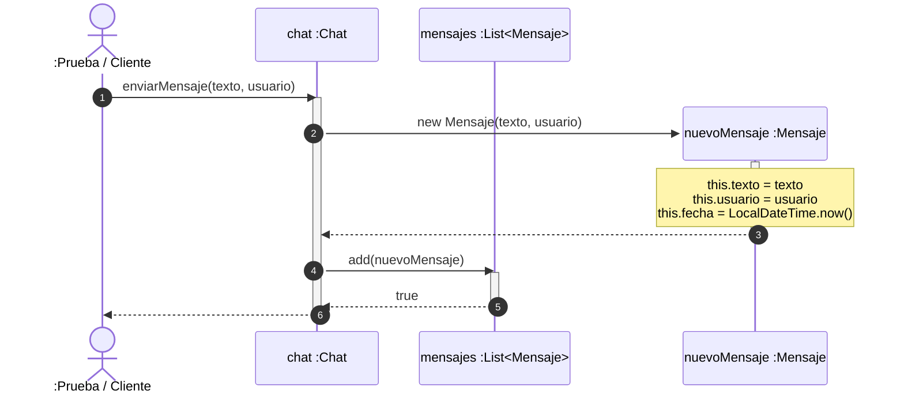

# Proyecto Chat Base

El código presente acá contiene un modelo base de Chat listo para ser re factorizado para que sea interactivo por consola.

# Diagrama de clases del proyecto Base

# Diagrama de Secuencias del Método `Chat.enviarMensaje(String, Usuario)`

